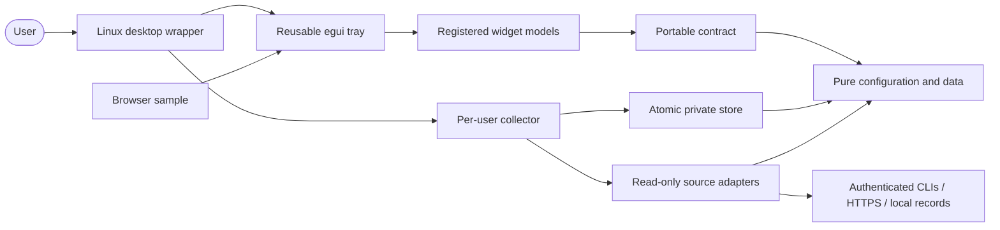

# Status Quo: design and development decisions

Last updated: 2026-11-02

## 1. What it is

Status Quo is an all-Rust Linux desktop tray containing independent widgets for assistant account usage, tokens, project sessions, recent GitHub activity and recent workflow-memory history. KDE is the first desktop wrapper. The approved [scope document](docs/2026-11-01-status-quo-design.md) defines behavior and delivery acceptance; [requirements](docs/REQUIREMENTS.md) retain stable `SQ-*` identifiers.

## 2. Architecture

Portable widget models do not open files or launch processes. Hosts receive explicit navigation intents and decide supported actions. The tray registers widget and style implementations; stable instance identities own order, size, filters, hidden/detached state and optional theme. Versioned IPC carries bounded requests and snapshots. Configuration updates use revision checks and atomic persistence. One kernel-held collector lock prevents concurrent writers. Source workers operate away from interface rendering and retain last valid data with explicit freshness/error state.

`tools/rust_architecture.rs` enforces portable manifest dependencies, permits only egui in the reusable tray, and rejects source IO/FFI in both layers. The shared pinned pipeline's legacy architecture scan does not cover Rust, so it is not presented as the Rust boundary proof. Compiler crate boundaries and the project check supplement each other. See [ADR-0002](docs/adr/0002-portable-rust-widgets.md).

## 3. Testing

The gate runs Rust formatting, Clippy with warnings denied, workspace tests, boundary detector regression tests, requirement traceability and the inherited 1200-second fitness limit. Tests target counter integrity, unknown values, malformed/partial records, configuration cancellation/conflicts, atomic persistence, bounded IPC and host-neutral registration. [Test record](docs/TESTES-AUTOMATIZADOS.md) separates observed evidence from unfinished desktop, package, lifecycle and performance acceptance. A requirement tag alone is not proof of its entire real-host behavior.

## 4. Decision log

| Date | Type | Decision | Why |
|---|---|---|---|
| 2026-11-02 | Corrective | Add host compatibility layer (layer-shell, X11 hints, plain window chosen at run time); tray becomes a frameless desktop-layer surface ([ADR-0003](docs/adr/0003-host-compatibility-layer.md)) | Giovanni: Status Quo must be a desktop widget environment and portable across Linux versions; a framed window is not one |
| 2026-11-02 | Corrective | Collector creates its own private `events` directory before watching it | A missing watched path forced the 2-second polling fallback and raised idle CPU from about 2% to 7.7% of one core; SQ-23 (under 1%) is still not met |
| 2026-11-02 | Preventive | Add project-specific Rust boundary detector and planted-defect self-tests; retain shared pipeline v0.4.0 and inherited 1200-second gate limit | Shared scanner supports Java/Kotlin, so an empty legacy scan must not imply Rust architectural verification |
| 2026-11-01 | Initial | Register reusable widget models and egui tray independently of the KDE-first Linux wrapper; versioned local collector transport ([ADR-0002](docs/adr/0002-portable-rust-widgets.md)) | User requires removable/interchangeable widgets and reuse of both widgets and tray in other environments |
| 2026-11-01 | Initial | Start from project-template commit `606b016d0e2d34e04d45be292724b40d2a181dc9` with requirements before implementation | Scope-driven development and the established template pipeline |

## 5. Acceptance status

Implementation is in progress. First five-minute observation: memory 115 MiB (meets target), CPU 2.05% of one core (misses the 1% target, cause open). Automated tests do not establish compositor stacking, installation/startup/uninstall, interactive latency, five-minute idle resource limits or source-matched wiki publication. These must be recorded from actual production invocations before release. Operational limitations belong in GitHub debt issues after a repository exists, with priority and reproduction; do not inherit the template repository's historical review claims.
