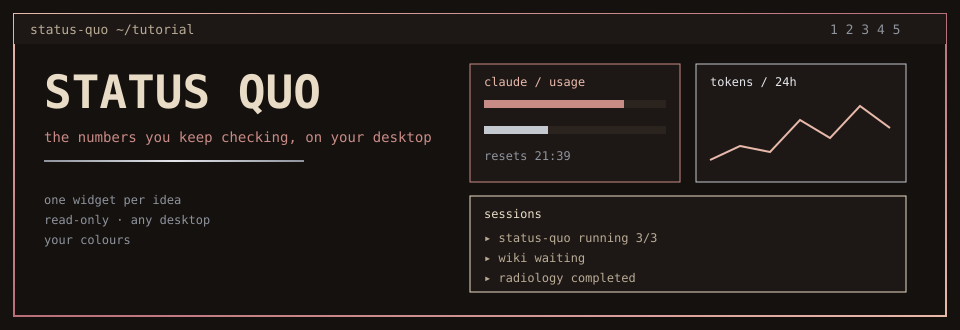
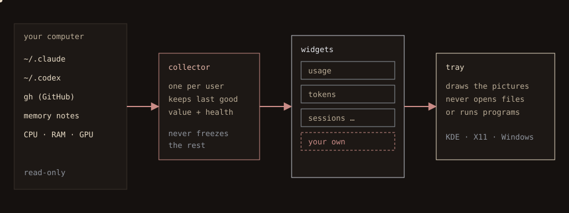
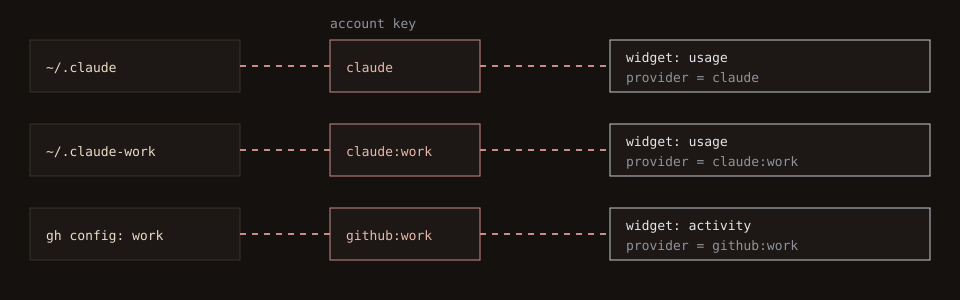
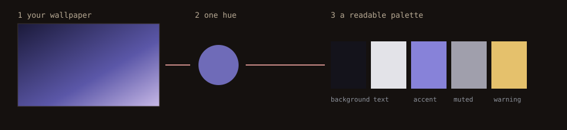

<p align="center"></p>

# Status Quo, a guided tour

> *What if the numbers you keep checking were simply there, on your desktop, without opening anything?*

This page teaches Status Quo the way a good lecture would: one idea at a time, a picture before the commands, and a reason for every step. Read it top to bottom once (about ten minutes), then use the chapter links as a manual. A styled, scrolling version of the same tour lives in [`docs/index.html`](docs/index.html).

| | Chapter | You will be able to |
|---|---|---|
| 1 | [The big picture](#1-the-big-picture) | explain how Status Quo works in one sentence |
| 2 | [Put it on your computer](#2-put-it-on-your-computer) | install it on Linux or Windows, in one command |
| 3 | [Your first minute](#3-your-first-minute) | move, resize and style widgets |
| 4 | [The widgets](#4-the-widgets) | pick the right widget for each number |
| 5 | [Plug in your accounts](#5-plug-in-your-accounts) | show more than one Claude, Codex or GitHub account |
| 6 | [Make it yours](#6-make-it-yours) | follow your wallpaper, choose where it sits |
| 7 | [Build your own widget](#7-build-your-own-widget) | add a widget that is not built in |
| 8 | [When something looks off](#8-when-something-looks-off) | find the cause in a minute |

---

## 1. The big picture

<p align="center"></p>

Watch the dots. They only ever travel **left to right**.

1. **Your computer** holds the facts: the Claude and Codex folders, the GitHub CLI, your notes, the processor, memory and graphics card.
2. **The collector** is one small background program per user. It *reads* those facts (it never writes them), keeps the last good value of each, and remembers whether a source is fresh, stale or broken. One broken source never freezes the others.
3. **Widgets** turn the collector's data into a picture description: a meter, a chart, a list. Every function of Status Quo is a widget, and every widget can be removed or replaced.
4. **The tray** draws those descriptions. It cannot open files or start programs, which is why it is safe to reuse on any desktop.

> **The one idea:** *the collector reads, widgets describe, the tray draws.* Everything else in this tour is a consequence of that sentence.

Nothing is sent anywhere. There are no analytics, no generated summaries and no stored conversations. Status Quo never creates or refreshes a login: it only reads what Claude, Codex and `gh` already saved.

## 2. Put it on your computer

**The fast way: one command.** It checks your computer, installs what is missing, builds or unpacks the program, installs it for your user only, starts it and prints a compatibility report.

```sh
# Linux (Debian/Ubuntu, Fedora, Arch and openSUSE families; sudo is asked only for packages)
git clone https://github.com/yujideluca/status-quo.git && cd status-quo
bash tools/install.sh
```

```text
Windows: double-click  status-quo-setup.exe   (one file, no administrator rights)
```

`status-quo-setup.exe` is attached to each tagged release; until the first release is published, every CI run uploads it as the artifact `status-quo-setup-windows` (Actions tab). Add `--dry-run` to either installer to see every step without doing it, `--check-only` (Linux) or `--check` (Windows) to only look, and `--uninstall` to remove it. The compatibility report is also a command you can run any time: `status-quo doctor`.

**The manual way**, if you prefer to see each step (it is what the installer does for you):

| You use | Door | Where the widgets live |
|---|---|---|
| Linux, KDE Plasma, Hyprland or sway | [Linux guide](docs/guide/install.md#linux-step-by-step) | on the desktop layer, behind your windows |
| Linux, an X11 session (any desktop) | [Linux guide](docs/guide/install.md#linux-step-by-step) | a frameless window kept below others |
| Linux, GNOME on Wayland | [Linux guide](docs/guide/install.md#linux-step-by-step) | an ordinary window |
| Windows 10 or 11 | [Windows guide](docs/guide/install.md#windows-step-by-step) | an ordinary window |
| Just curious | [Browser demo](docs/browser-demo.md) | a web page with invented data |

The short version for Linux by hand:

```sh
# 1. Rust 1.87 or newer (https://rustup.rs), plus the drawing libraries (Debian/Ubuntu names):
sudo apt-get install -y pkg-config libx11-dev libxkbcommon-dev libwayland-dev libgl1-mesa-dev

# 2. Build, then let Status Quo install itself for your user only (no sudo):
git clone https://github.com/yujideluca/status-quo.git && cd status-quo
cargo build --release --locked -p status-quo
target/release/status-quo install
```

And for Windows by hand (PowerShell, after installing Rust with the MSVC build tools):

```powershell
git clone https://github.com/yujideluca/status-quo.git; cd status-quo
cargo build --release --locked -p status-quo
target\release\status-quo.exe install
```

`install` copies the program into your user folders, registers it to start at login, and adds small lifecycle hooks to Claude and Codex *without touching the hooks you already have*. `status-quo uninstall` reverses it and keeps your layouts and history. Every file it owns is listed in the [install guide](docs/guide/install.md#what-install-does).

## 3. Your first minute

Run `status-quo`. After a few seconds the collector has its first readings and the widgets fill in. Three small buttons sit in the corner:

| Button | What it does |
|---|---|
| **+ Add widget** | A menu of every widget type for every account you have. |
| **Edit tray** | Turns the tray into a canvas: drag a widget to move it, drag any edge or corner to resize it, press **Remove** in its centre to delete it. Borders snap to neighbours, and pink and blue guide lines show what lines up. **Done** saves, **Cancel** discards. |
| **Customize** | Colours, text size, opacity, spacing, where the tray sits, which folders to read, and each widget's own settings. |

Nothing you do in Edit tray or Customize is final until you press **Save changes** or **Done**; **Cancel** brings back what you had. If you lock the layout in Customize, Edit tray stays disabled until you unlock it.

## 4. The widgets

Eight widgets are built in. Each one is independent: add the same kind twice, give each its own account, size and colours.

| Widget | Shows | Accounts | Options you can set |
|---|---|---|---|
| `quota` | percent of the five-hour and weekly limits used, and when they reset | `claude`, `codex` | none |
| `tokens` | token graph with input, output and cache | `claude`, `codex` | `range` = `24h` (default), `7d`, `30d`; `bucket` = `hourly` (default) or `daily`; `cumulative` = `true` |
| `sessions` | your assistant sessions grouped by project, with subagents and a done/total count when the session keeps a task list | `both`, `claude`, `codex` | `history` = `true` to keep finished sessions listed |
| `activity` | recent commits, pull requests, issues, releases and checks of chosen repositories | `github` | `repository` = `owner/name` to show one repository |
| `memory` | recent entries of your workflow-memory notes | `both`, `claude`, `codex` | `type` to show one kind of entry |
| `system` | CPU share and temperature, last ten minutes | `local` | none |
| `ram` | memory and swap use | `local` | none |
| `gpu` | every graphics card, of any maker, several at once | `local` | none |

A value Status Quo cannot read is shown as **unavailable**, never as zero. A sleeping second graphics card is never woken up just to measure it. More detail, with every option, in the [widget guide](docs/guide/widgets.md).

## 5. Plug in your accounts

<p align="center"></p>

An **account key** is the short name a widget uses to pick one sign-in: `claude`, `codex` and `github` are your default accounts, and extra accounts are written `kind:name`, for example `claude:work`.

1. **Default accounts need no setup.** Sign in with the tool itself (`claude`, `codex`, `gh auth login`), and Status Quo reads what the tool saved.
2. **An extra account** is a second home folder: open **Customize → More accounts → + Add account**, choose the kind, give it a short name, then press **Browse…** and pick its folder (the folder `CLAUDE_CONFIG_DIR` or `CODEX_HOME` names for Claude and Codex, or the `gh` configuration folder for GitHub). For GitHub, list the repositories it should read, one `owner/name` per line.
3. **Tell each widget which account to show:** open the widget in Customize, or choose the account directly in the **+ Add widget** menu (it lists `claude / Account usage`, `claude:work / Account usage`, …).

A widget set to an account that does not exist says **unknown**; it never borrows another account's numbers. The full walk-through, including where each tool keeps its folder, is the [accounts guide](docs/guide/accounts.md).

## 6. Make it yours

<p align="center"></p>

* **Follow the wallpaper.** In **Customize → Appearance**, tick *Follow the wallpaper colours*. Status Quo shrinks your wallpaper to one dominant hue and builds a palette that stays readable (text at least 7:1 against the background, other colours at least 4.5:1). A grey wallpaper gives a neutral palette: no colour is invented. It works on KDE, GNOME and its relatives, Xfce, LXQt/LXDE, nitrogen/feh, hyprpaper and Windows; for anything else, point `STATUS_QUO_WALLPAPER` at the picture.
* **Light, dark or system mode**, opacity, font size, spacing, and a different look per widget.
* **Where it sits.** Layer, anchor corner, start at login. Environment variables force a choice when automatic detection is wrong: `STATUS_QUO_HOST` (`layer-shell`, `x11` or `window`) and `STATUS_QUO_ANCHOR` (for example `bottom-left`).
* **Folders to read.** Every source path has a **Browse…** button, a small folder navigator for people who would rather not type paths.
* **Presets and sharing.** Save the current look as a preset, or export and import your settings as text. Imports are validated first, so a broken file can never replace a good setup.

All of it, with the exact names, is in the [customization guide](docs/guide/make-it-yours.md).

## 7. Build your own widget

Because every function is a widget, adding one never means touching the others. A widget is a small Rust type with two methods: *who am I* and *what do I show right now*.

```rust
struct Note;
impl Widget for Note {
    fn descriptor(&self) -> Descriptor {
        Descriptor { kind: "note".into(), title: "Note".into(), providers: vec!["local".into()] }
    }
    fn view(&self, instance: &WidgetInstance, _snapshot: &Snapshot, _now: i64) -> View {
        let text = instance.options.get("text").cloned()
            .unwrap_or_else(|| "Set the text option of this widget".into());
        View { title: "Note".into(), nodes: vec![Node::Text(text)] }
    }
}
```

Register it once (`tray.registry.register(Box::new(Note))`) and it shows up in **+ Add widget** next to the built-in ones, with its own size, colours and options. The [widget-building guide](docs/guide/build-a-widget.md) grows this example step by step: options, meters, charts, rows that open links, reading collector data, and testing it. That guide's code is compiled by the project's own tests, so it cannot quietly go out of date. Widgets are compiled in; there is no runtime plugin loading yet.

## 8. When something looks off

| You see | Try |
|---|---|
| **unavailable** in a widget | The source has no value yet or cannot be read. The notice inside the widget names the reason (for example a stale source or malformed records). |
| Nothing at all after install | Run `status-quo inspect`. If it prints JSON, the collector works and the panel is the issue; if it errors, run `status-quo collect` in a terminal and read the message. |
| The tray is a normal window, not on the desktop | Your desktop does not offer the desktop-layer protocol. That is expected on GNOME/Wayland and Windows. See [hosts](docs/guide/install.md#how-it-sits-on-your-desktop). |
| Wallpaper colours do nothing | Customize shows the reason next to the checkbox (wallpaper not found, or a picture format that cannot be read). |
| A session shows no progress count | The session keeps no task list. Counts come from the assistant's own task list, never a guess. |

Contributors: build, quality gate and structure are in [`docs/DEVELOPMENT.md`](docs/DEVELOPMENT.md); decisions in [`DESIGN.md`](DESIGN.md) and the [requirements](docs/REQUIREMENTS.md).

*This repository is under active development. A passing build alone does not prove behaviour on your particular desktop; the guides say what has and has not been verified.*
